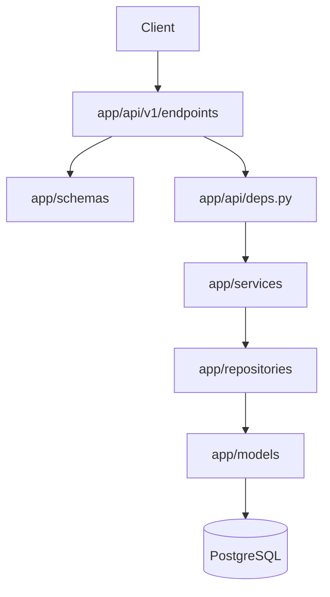
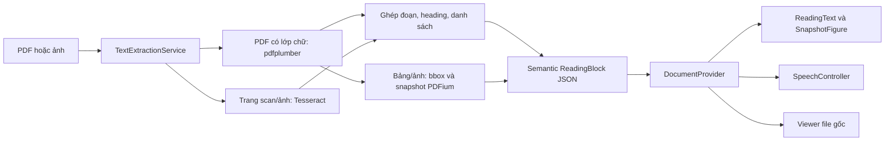

# Kiến trúc tổng thể

Repo là monorepo gồm backend FastAPI và frontend Vite/React. Chưa có CI config được phát hiện; các lệnh chính nằm trong `requirements.txt`, `pytest.ini` và `frontend/package.json`.

## Backend

`app/main.py` tạo FastAPI app, bật CORS từ `BACKEND_CORS_ORIGINS`, đăng ký `/health` và router `/api/v1`. Các route được gom tại `app/api/v1/router.py`.

Luồng request chính:

- `schemas` kiểm tra input/output và alias JSON camelCase.
- `services` xử lý nghiệp vụ, hash password và chuyển lỗi domain.
- `repositories` thực hiện query/commit SQLAlchemy.
- `db/session.py` cấp một `Session` cho request; `core/exceptions.py` được `main.py` chuyển thành JSON `detail`.
- Auth dùng JWT HS256: `/auth/login` phát token, `CurrentUser` giải mã Bearer token và tải user active.

## Dữ liệu và migration

PostgreSQL được cấu hình bằng `DATABASE_URL`. `users` lưu tài khoản và password hash. `display_settings` có `user_id` vừa là primary key vừa là foreign key tới `users.id`, nên mỗi user tối đa một bản ghi; FK dùng cascade khi user bị xóa. Cấu trúc được quản lý bởi Alembic trong `alembic/versions/`.

## Frontend

`frontend/src/main.tsx` mount `App` trong các provider auth, display settings và document. `App.tsx` định tuyến `/`, `/reading`, `/auth`, `/login`, `/register`; các path khác redirect về `/`. `src/lib/api.ts` là client fetch chung, lấy base URL từ `VITE_API_URL` và token từ `localStorage` key `token`.

Trang chủ nhận văn bản dán hoặc upload PDF/ảnh qua `POST /api/v1/documents/extract-text`. `DocumentProvider` giữ `ReadingDocument` trong bộ nhớ: file gốc, source text, block gốc, block đang sửa và cảnh báo. `text` được dẫn xuất từ block để dùng cho bộ đếm và TTS. Refresh sẽ mất tài liệu hiện tại.

## Pipeline tài liệu và trình đọc

Parser hiện tại không dùng Docling hay LLM. `app/services/layout_pdf.py` xử lý tọa độ/font, tách cột theo khoảng trắng, lọc phần lặp ở mép trang và tạo snapshot PNG của bảng/ảnh. Chữ trong vùng snapshot không được render lại ở paragraph. Snapshot có text thay thế cho TTS/sao chép, nhưng font bên trong ảnh dùng zoom riêng. Lỗi parser được trả về rõ ràng thay vì fallback text phá bố cục.

`MinimalReadingView` mặc định mở “Trang đọc”: mục lục theo heading, font/cỡ/giãn dòng/giãn chữ/cột/theme và focus mode. `LayoutEditor` cho sửa/tách/gộp/đổi thứ tự khối chữ; `OriginalDocumentView` dùng object URL của file để đối chiếu và thu hồi URL khi đổi tài liệu. Xem hợp đồng, giới hạn và lệnh QA ở [module trình đọc](modules/document-reader.md).

## Phụ thuộc ngoài

- PostgreSQL là phụ thuộc runtime và test.
- PDF có lớp chữ dùng pdfplumber + pypdfium2; OCR cần Tesseract với dữ liệu `vie` và `eng`. Backend giới hạn mặc định 10MB/tệp, 100 trang PDF và 10 trang OCR.
- Test parser mang marker `no_db`, chạy độc lập PostgreSQL; integration test DB dùng database có hậu tố `_test`.
- Browser cung cấp `localStorage` và fetch; Vite dev server mặc định phục vụ frontend ở cổng 5173.
- CORS mặc định cho `http://localhost:5173` và `http://127.0.0.1:5173` qua `.env.example`.
