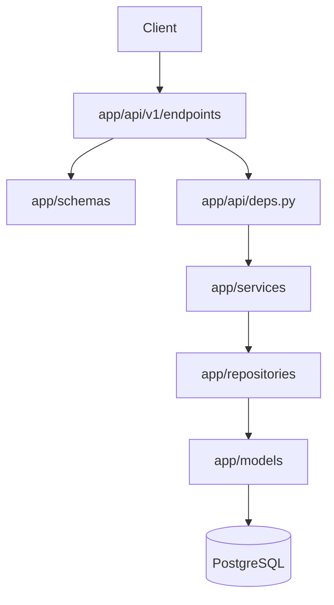

# Kiến trúc tổng thể

Repo là monorepo gồm backend FastAPI và frontend Vite/React. Chưa có CI config được phát hiện; các lệnh chính nằm trong `requirements.txt`, `pytest.ini` và `frontend/package.json`.

## Backend

`app/main.py` tạo FastAPI app, bật CORS từ `BACKEND_CORS_ORIGINS`, đăng ký `/health` và router `/api/v1`. Các route được gom tại `app/api/v1/router.py`.

Luồng request chính:

- `schemas` kiểm tra input/output và alias JSON camelCase.
- `services` xử lý nghiệp vụ, hash password và chuyển lỗi domain.
- `repositories` thực hiện query/commit SQLAlchemy.
- `db/session.py` cấp một `Session` cho request; `core/exceptions.py` được `main.py` chuyển thành JSON `detail`.
- Auth dùng JWT HS256: `/auth/login` phát token, `CurrentUser` giải mã Bearer token và tải user active.

## Dữ liệu và migration

PostgreSQL được cấu hình bằng `DATABASE_URL`. `users` lưu tài khoản và password hash. `display_settings` có `user_id` vừa là primary key vừa là foreign key tới `users.id`, nên mỗi user tối đa một bản ghi; FK dùng cascade khi user bị xóa. Cấu trúc được quản lý bởi Alembic trong `alembic/versions/`.

## Frontend

`frontend/src/main.tsx` mount `App` trong `AuthProvider`. `App.tsx` định tuyến `/`, `/reading`, `/auth`, `/login`, `/register`; các path khác redirect về `/`. `src/lib/api.ts` là client fetch chung, lấy base URL từ `VITE_API_URL` và token từ `localStorage` key `token`.

Frontend hiện có màn hình và mock data; API client đã có auth/health/user calls nhưng chưa thấy luồng đọc tài liệu thật nối vào backend.

## Phụ thuộc ngoài

- PostgreSQL là phụ thuộc runtime và test.
- Browser cung cấp `localStorage` và fetch; Vite dev server mặc định phục vụ frontend ở cổng 5173.
- CORS mặc định cho `http://localhost:5173` và `http://127.0.0.1:5173` qua `.env.example`.
